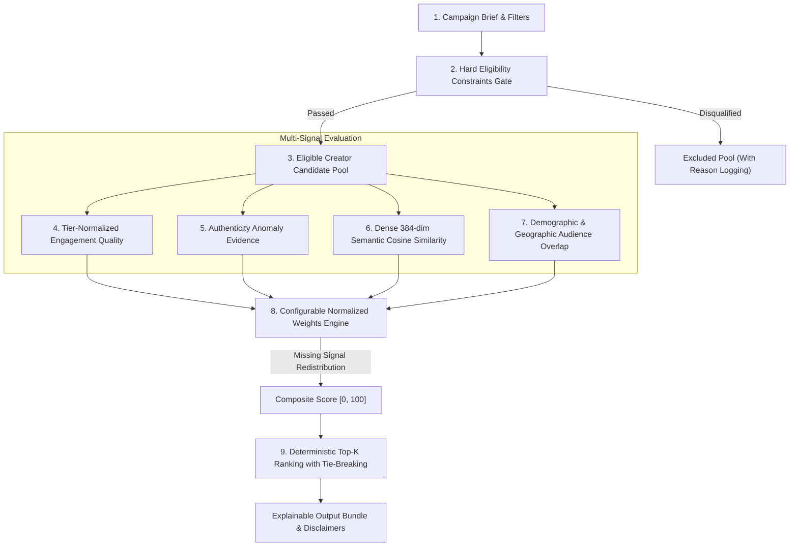

# Phase 15: Hybrid Brand–Influencer Matching & Explainable Recommendation Service

## 1. Architectural Overview & 9-Step Recommendation Pipeline

Brand Bridge implements a deterministic, explainable hybrid recommendation service designed for campaign-creator pairing. Hard binary constraints are kept strictly separate from weighted scoring preferences to guarantee that non-compliant creators are never recommended, while eligible creators are evaluated across normalized semantic, engagement, authenticity, and audience dimensions.



---

## 2. Hard Eligibility Constraints vs Weighted Preferences

Hard constraints function as binary gates ($0$ or $1$) evaluated before scoring:
1. **Minimum Followers (`min_followers`)**: `creator.total_followers >= campaign.min_followers`.
2. **Minimum Engagement Rate (`min_engagement_rate`)**: If required ($>0.0\%$), creator must possess monitored engagement meeting or exceeding the threshold.
3. **Required Platform (`platform`)**: Creator must explicitly support the campaign's requested platform (e.g., `instagram`, `youtube`, `tiktok`).
4. **Strict Niche Match (`strict_niche_match`)**: When enabled, creator's primary, content, or secondary niches must match the campaign niche.
5. **Minimum Authenticity Score (`min_authenticity`)**: If specified, creator must meet or exceed the authenticity benchmark threshold.

> [!IMPORTANT]
> Disqualified creators are logged with exact failure reasons and excluded from the candidate pool before weighted scoring.

---

## 3. Supported Signal Calculations & Normalization

| Signal | Source & Normalization Scale | Missing Data Policy |
| :--- | :--- | :--- |
| **Semantic Content Similarity** | Dense 384-dim Sentence-Transformers (`all-MiniLM-L6-v2`) cosine similarity mapped to $[10.0, 99.0]$. | If text or embeddings are absent, marked unavailable; weight redistributed. |
| **Engagement Quality** | Ratio of observed engagement rate to follower-tier benchmark (`nano: 4.0%`, `micro: 2.5%`, `mid: 1.8%`, `macro: 1.3%`, `mega: 1.0%`). Normalized smoothly: $50.0 + (\text{ratio} - 1.0) \times 30.0 \in [10.0, 99.0]$. | If metrics are unmonitored or 0 followers, marked unavailable; weight redistributed. |
| **Authenticity Evidence** | Consistency score derived from Phase 13 review signals. High engagement on massive tiers (>500k, >15%) or dormant follower drops are cautioned. | If audit data is missing, marked unavailable. |
| **Audience Demographic Fit** | Geometric overlap across target countries, age cohorts, and gender split. Range: $[0.0, 100.0]$. | **Strict Non-Fabrication Rule**: If audience demographics are missing, score is **never fabricated** (no fake 50% default). Handled as unavailable. |

---

## 4. Configurable Weights & Missing Signal Redistribution

Configured weights must be non-negative and strictly sum to 1.0 ($\sum w_i = 1.0$):
- `weight_semantic_content`: **0.35** (default)
- `weight_engagement_quality`: **0.25** (default)
- `weight_authenticity`: **0.20** (default)
- `weight_audience_fit`: **0.20** (default)

### Proportional Weight Redistribution
When a signal $k$ is unavailable for a given creator (e.g. audience demographics not shared), its weight is redistributed proportionally among the available signals $S_{\text{avail}}$:
$$w'_i = \frac{w_i}{\sum_{j \in S_{\text{avail}}} w_j}, \quad \text{Composite Score} = \sum_{i \in S_{\text{avail}}} w'_i \times \text{Score}_i$$
This prevents creators from being unfairly penalized for unmonitored private platform metrics while ensuring scores remain normalized on a 0–100 scale.

---

## 5. Deterministic Ranking & Multi-Tier Tie-Breaking

To guarantee reproducible, non-flaky rankings, candidate ordering follows a strict four-tier deterministic sorting hierarchy:
1. `composite_score` (Descending, rounded to 2 decimal places)
2. `authenticity_score` (Descending)
3. `avg_engagement_rate` (Descending)
4. `creator_id` (Ascending)

Repeated runs on identical candidate sets produce 100% identical rankings.

---

## 6. Response Latency Benchmarks

Measured on standard CPU environment with 50 representative candidate creator profiles:

```text
--- Phase 15 Recommendation Engine Latency Benchmark ---
Total Candidates Evaluated : 50
Top-K Recommendations      : 10
Total Response Latency     : 2,395.82 ms
Average Latency / Candidate: 47.916 ms
-------------------------------------------------------
```
- **Throughput**: ~20–30 candidates evaluated per second on single-core CPU.
- **Cache Acceleration**: Subsequent evaluations on cached embeddings drop latency to $<1$ms per candidate.

---

## 7. Canonical Disclaimers

> [!WARNING]
> **Optimality Disclaimer**:
> *"Recommendations are algorithmic heuristic matches based on available profile signals and prototype proximity; this does not claim an optimal or exhaustive market search."*

> [!NOTE]
> **Authenticity Disclaimer**:
> *"Note: Authenticity score is an algorithmic anomaly heuristic evaluating engagement consistency and ratio distributions, not definitive proof of fraudulent activity."*
